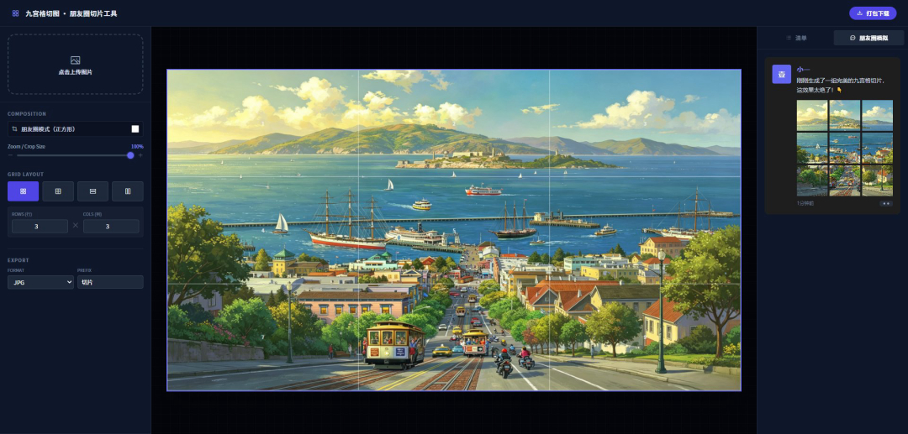

# 九宫格切图 · 朋友圈切图工具

纯前端图片切图工具，无需后端、无需安装，打开即用。
支持九宫格切图、全景长图竖切、长图自定义切分，所有操作均在浏览器本地完成。

[](LICENSE)




## ✨ 特性一览

- 🖱️ **自由拖拽切图**：上传照片后随意拖动选框，主角永远在 C 位
- 🔒 **强制 1:1 完美九宫格**：朋友圈模式自动锁定正方形比例，发圈严丝合缝
- 👀 **实时预览**：右侧自带朋友圈模拟器，边切边看效果，不满意随时调
- 🌄 **全景长图竖切**：3x1 模式无损切分宽幅全景图
- 📜 **长图自定义切分**：任意行 x 列组合，长截图秒变轮播图
- 🎨 **无损 PNG 导出**：支持透明背景，切 UI 素材、Logo 边缘干净利落
- 📦 **ZIP 一键打包**：支持单张下载，也支持压缩包一键导出
- 🛡️ **隐私安全**：图片永不上传服务器，全部在浏览器本地处理

## 🎯 这是一个"懂你"的九宫格切图工具

很多时候我们想发九宫格，是因为一张图太小，想把画面撑满屏幕。但普通的切图 APP 往往会把主角的脸切一半，或者把构图切得很奇怪。

本工具重新定义了"切图"体验：

- **自由拖拽切图** —— 上传照片后，你可以随意拖动选框。想切左边就切左边，想切中间就切中间，主角永远在 C 位。
- **强制 1:1 完美九宫格** —— 只要开启"朋友圈模式"，系统会自动锁定正方形比例。切出来的 9 张图，发到朋友圈里严丝合缝，没有任何白边和错位。
- **实时预览** —— 右侧自带朋友圈模拟器，你一边切，右边一边显示发出去的效果。不满意？随时调，直到完美为止。

## 🌅 不止九宫格，更是"全景长图"发图神器

这可能是摄影爱好者最需要的功能。

> **痛点**：拍了一张横屏全景图，直接发朋友圈会缩成一条细线，根本看不清。
>
> **解法**：使用 **3x1 竖切模式**。

它能把一张宽幅全景图无损切分成 3 张竖图。当你把这 3 张图按顺序发到朋友圈时，它们会并排无缝拼接。朋友们向左滑动查看，仿佛在手机上展开了一幅高清画卷！

这才是全景图的正确打开方式。

## 🛠️ 长图防压缩 & UI 切图好帮手

除了朋友圈，它还能解决更多专业需求：

| 场景 | 用法 |
| --- | --- |
| **网页长截图发小红书** | 使用自定义切分（如 10 行 x 1 列），切成 10 张大图发轮播，字字清晰 |
| **切 UI 素材 / Logo** | 选择 PNG 无损导出，支持透明背景，行数列数自由输入 |
| **批量保存** | 可单张下载，也可一键下载 ZIP 压缩包 |

## 🚀 快速开始

无需安装任何依赖，直接用浏览器打开 `index.html` 即可使用。

```bash
# 或者本地起个静态服务（可选）
npx serve .
```

1. 点击左上角上传照片
2. 拖动选框调整构图，选择网格布局（九宫格 / 3x1 / 自定义行列）
3. 在右侧实时预览效果
4. 选择导出格式（JPG / PNG），单张下载或打包 ZIP

## 🔒 隐私说明

作为一款网页版切图工具，所有图片处理均在你自己的浏览器中完成，**图片不会上传到任何服务器**，安全无忧。

## 📄 License

[MIT](LICENSE)
